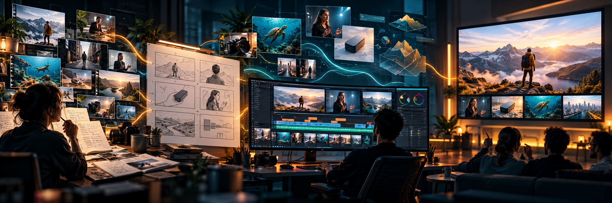

# All-Purpose Video Production Skills for Any LLM



**Repository:** [github.com/pritoo733/video-creation-and-editing-skills](https://github.com/pritoo733/video-creation-and-editing-skills)

Reusable, LLM-provider-neutral skills for the full video lifecycle: research, concept development, scripting, asset preparation, video creation, editing, quality review, and delivery. They support personal stories, explainers, product demos, marketing pieces, social clips, events, footage recuts, motion graphics, and AI-assisted video.

The skills follow the open [Agent Skills format](https://agentskills.io/specification): a folder with a `SKILL.md` file and optional references or templates. They work directly in agent products that load this format. Other LLM setups can use them by adding the relevant `SKILL.md` and referenced files to the model's instructions/context. The skills do not depend on a specific model provider; access to browsing, editing, voice, and video-generation tools depends on the host environment.

The workflow emphasizes evidence-backed scripts, motion planned around story beats, reference-video analysis, source-grounded recaps and dubs, an early representative sample, and a coverage-based review of the export. It was informed by [awesome-claude-video-skills](https://github.com/zhuyansen/awesome-claude-video-skills), [lanshu-create-ai-presenter-video](https://github.com/cclank/lanshu-create-ai-presenter-video), [video-production-skills](https://github.com/Pluviobyte/video-production-skills), [video-shotcraft](https://github.com/Vincentwei1021/video-shotcraft), [Violin](https://github.com/shang-zhu/violin), [video-recap-skills](https://github.com/zenstory-ai/video-recap-skills), [Recordly](https://github.com/webadderallorg/Recordly), [chatgpt-video-editing-skills](https://github.com/Jaycheng1103/chatgpt-video-editing-skills), [chengfeng-videocut-skills](https://github.com/Agentchengfeng/chengfeng-videocut-skills), [jianying-editor-skill](https://github.com/luoluoluo22/jianying-editor-skill), [OpenMontage](https://github.com/calesthio/OpenMontage), [OpenCreator](https://github.com/krillinai/OpenCreator), [remotion-video-skill](https://github.com/wshuyi/remotion-video-skill), [video-editing-skill](https://github.com/maxazure/video-editing-skill), and [video-use](https://github.com/browser-use/video-use). This repository adopts transferable workflow ideas without requiring any listed provider, editor, or toolkit.

## Skills

- [`creating-videos`](skills/creating-videos/SKILL.md) — take a video from idea through research, script, production, editing, review, and a finished export.
- [`editing-videos`](skills/editing-videos/SKILL.md) — revise, recut, caption, enhance, review, and export existing video while keeping edits reproducible.

### Choose a workflow

| Request | Start here |
| --- | --- |
| Make a new video from an idea, topic, or brief | `creating-videos` |
| Turn supplied raw footage into a new story, recap, or dub | `creating-videos` + its source-based video guide |
| Record a product walkthrough or presenter video | `creating-videos` + the matching specialist guide |
| Change, caption, polish, or review an already assembled cut | `editing-videos` |

See the [worked example](examples/sample-explainer.md) for one brief carried through a script, scene plan, and final review record.

For footage-led promos and social edits, start with the [visual storytelling guide](skills/creating-videos/references/visual-storytelling.md), [stock sourcing and license checks](skills/creating-videos/references/stock-footage.md), and [tool selection guide](skills/creating-videos/references/production-tooling.md). Plan source actions with the [shot list](templates/shot-list.md) and [asset ledger](templates/asset-ledger.json), then review a rendered multi-shot pilot. These workflows support real footage, product captures, original animation, and mixed edits; static slides are a deliberate format choice.

The optional [local shot composer](skills/editing-videos/references/shot-composition.md) uses Python standard library and installed FFmpeg to trim/reframe media, animate overlays, join shots, add captions, and export a final mix. It includes timing/source checks, cache logs, and edit records. `audit_visual_sequence.py` checks distinct consecutive visuals and narration-linked shot metadata before rendering. `motion_diagnostics.py` helps locate near-static passages for review; it does not score creative quality.

See the [investigation and validated before/after example](examples/footage-promo/validation.md) for the failure analysis, selected stock sources, observed repairs, comparison frames, test results, and review limits.

For website and app videos, follow [interface framing and scrolling](skills/editing-videos/references/interface-motion.md). UI shots default to showing the full frame at a fixed scale; the composer also supports a constant-scale vertical viewport over tall captures, with eased movement and reading pauses. Use real browser recordings for interactive behavior and verify readability at the intended viewing size.

For raw-footage edits, use the [local footage-first workflow](skills/editing-videos/references/raw-footage-workflow.md): inspect and transcribe first, plan a reversible edit decision list, smooth cut boundaries, then review every join. For readable, accurate subtitles use the [caption workflow](skills/editing-videos/references/caption-workflow.md), which includes a local word-level correction stage. For custom animation and sound, use the [motion-graphics guide](skills/creating-videos/references/motion-graphics.md) and [voice and music guide](skills/creating-videos/references/voice-and-music.md); both distinguish permissive project code from the separate terms for model weights, voices, and media.

For frame-accurate, graphics-led or hybrid video scenes, see the optional [HyperFrames local workflow](skills/creating-videos/references/hyperframes-local-workflow.md). It adds an editable HTML animation route with local preview and rendering, a story-led catalog selection process, and a reusable [catalog license review template](templates/hyperframes-catalog-review.md); the existing footage composer remains the route for source-heavy edits and scrolling interface captures.

For richer custom HTML, SVG, or React motion design, see the optional [Motion library video workflow](skills/creating-videos/references/motion-library-workflow.md). The automatic Python renderer now makes original animated process, chart, cycle, and comparison graphics locally; Motion remains an optional animation layer for projects using a frame-seekable renderer.

For **custom motion-design films**, use [motion-design production](skills/creating-videos/references/motion-design-production.md). It adds story-led object transformations, masked type, connected scene handoffs, frame-aligned sound planning, and a local HTML/Canvas renderer. The [original editable study](skills/creating-videos/assets/motion-starter/index.html) demonstrates these techniques in landscape and portrait without external media or animation packages. The renderer requires free Playwright/Chromium and FFmpeg, exports silent visuals for finishing with the editing workflow, saves scene/transition snapshots, blocks remote asset requests, and checks reverse-seek consistency. This route is available to any LLM with local tool access; it is not tied to the model named by a showcase. Its visual treatment should be newly designed for each project.

See the [motion-design validation record](examples/motion-design/validation.md) for the actual pilot render, portrait checks, integration tests, and review limits.

For stronger audience-led scripts, see [audience, hooks, packaging, and retention](skills/creating-videos/references/audience-hooks-and-retention.md). Informed by [youtube-agent-skill](https://github.com/Jakeschincariol/youtube-agent-skill), it adds an adapted 21-category hook library, an audience/voice profile, title-thumbnail-opening planning, explicit promise-to-payoff mapping, context-preserving Shorts, and a feedback loop. Two original Python stdlib helpers check hook/script packages and describe normalized retention exports locally. They need no API key or paid service, and make no virality or causal-retention prediction. The upstream MIT notice is retained with the adapted taxonomy.

For reference-assisted visual direction, use the [searchable prompt-library workflow](skills/creating-videos/references/reference-library-workflow.md), informed by [awesome-opus5-5-videos](https://github.com/yihui-dev/awesome-opus5-5-videos). The free local helper can cache a reviewed snapshot, retrieve relevant prompts, preserve creator links/license/provenance, flag missing context and tool dependencies, and deduplicate repeated prompts. Use the [reference treatment](templates/reference-treatment.md) to turn selected techniques into a new production prompt, then render and inspect a pilot with the existing local motion or footage workflow. Collection caches and source media stay in project working directories; the skills are usable across LLM providers.

### Create a video with no supplied footage and no paid services

The optional [automatic free production route](skills/creating-videos/references/automatic-free-production.md) can start from a topic or brief. The LLM researches and writes the video plan; the local Python runner finds eligible Commons clips, creates original animated graphics, generates local narration and captions, mixes tracks, and exports a cut with an editable manifest. No API key or paid generator is used. A complete sample plan is in [`examples/automatic-free/plan.json`](examples/automatic-free/plan.json).

Install the free local runtime once from this repository root:

```powershell
python skills/creating-videos/scripts/setup_free_tools.py --dest .video-tools
python skills/creating-videos/scripts/doctor_free_tools.py .video-tools/runtime.json
```

Then ask your LLM to research a topic and audience, create a varied narration-matched plan from the example, and render it:

```powershell
.\.video-tools\Scripts\python.exe skills\creating-videos\scripts\auto_produce.py path\to\plan.json --output path\to\project\output --runtime .video-tools\runtime.json
```

For a visual checkpoint before the final encode, add `--draft-only`. The workflow writes a portable `storyboard.html` with each shot preview beside its narration, intent, source, and license. Review and revise the plan, then rerun without that flag. This adopts OpenMontage's useful scene-board and staged-production ideas while keeping this route local and free: no paid generation provider, paid stock library, or paid API is used. The full run also records its stages and errors in `production-log.json`.

Inspect the output contact sheet, clip previews, source/license evidence, full video, captions, and review report. The route can only use suitable public media it can find, and does not clear personality, property, trademark, or factual claims automatically. A completed encode is not a completed creative review. Setup and the initial local speech-recognition model require an internet connection; production runs locally afterward. Package, voice, and footage licenses still apply. No output-quality guarantee can replace editorial review.

## Install in an agent

From a local clone, install both skills and shared templates into the directory scanned by your LLM agent. The installer also adjusts template references in the installed copies, so they work outside the checkout. For example, on Windows PowerShell:

```powershell
$agentSkillsDirectory = 'SET_TO_YOUR_AGENT_SKILLS_DIRECTORY'
python scripts/install_skills.py --dest $agentSkillsDirectory
```

Inspect local customizations before using `--update`, which overwrites matching repository files while retaining unrelated files. If your agent has no skill loader, include the desired `SKILL.md` and relevant linked references in the task context. Use the invocation method supported by your agent, or ask for the video workflow in plain language. Media tools remain separate dependencies.

## Start a project

1. Copy [`templates/production-brief.md`](templates/production-brief.md) into your project and describe its purpose, audience, tone, source material, destination, and rights.
2. Research and script using [`research-and-script-ledger.md`](templates/research-and-script-ledger.md) when factual material needs sources.
3. Choose a creative mode, write a visual treatment, gather or create visuals, and plan scenes from [`scene-manifest.example.json`](templates/scene-manifest.example.json). For motion-led work, use the [visual beat sheet](templates/visual-beat-sheet.md) and save successful patterns with the [shot recipe](templates/shot-recipe.md). For a supplied reference, recap, or dub, load the [reference-video](skills/creating-videos/references/reference-video-analysis.md) or [source-based video guide](skills/creating-videos/references/source-based-video.md). For presenter or talking-head videos, follow the optional [presenter workflow](skills/creating-videos/references/presenter-workflow.md). For multi-step videos, copy the [`coverage matrix`](templates/coverage-matrix.md) to track every required point through final review.
4. Keep project scripts, footage, generated assets, audio, timelines, and exports in the project folder. This repo contains no footage or account data.
5. Invoke `creating-videos` to carry the work through production, editing, review, and final delivery. Invoke `editing-videos` on its own when an assembled cut only needs changes or review.

## Tooling and rights

The [voice and music guide](skills/creating-videos/references/voice-and-music.md) records the current license boundary: OmniVoice's code is Apache-2.0, but pretrained weights are CC BY-NC and are not suitable for commercial outputs. ACE-Step 1.5 is documented as an optional local music route with MIT terms; confirm current upstream terms and hardware before installing. No model is bundled, and voice cloning always requires speaker authorization.

For details on p5.brush effects, local model setup boundaries, captions, and raw-footage editing patterns, follow the linked guides above. The automatic-free renderer remains lightweight; heavyweight music-generation and animation runtimes are opt-in.

The skills support source footage, photos, screen recordings, animation, generated video, voiceover, and mixed-media projects. The automatic-free workflow uses local Pocket TTS narration by default; Piper remains available as a lightweight fallback. FFmpeg and optional editing or connected generation tools are also supported. Pocket TTS has separate model and voice terms, and its current model download requires accepting Hugging Face access terms. Confirm access, actual capabilities, pricing, and rights before relying on a tool. Never start a paid job, subscription, or trial without the user's explicit approval. Voice choice is configurable; verify the exact model and underlying dataset terms for the intended use. An earlier audition does not establish commercial rights. Treat external processing, stock assets, music, and publishing as separate choices that require appropriate authorization.

## Repository scope

This repository provides workflow instructions and templates. It does not include the example video, transcript, footage, screenshots, voice models, or project-specific scripts. Clone it locally and add project assets in a separate working directory.
