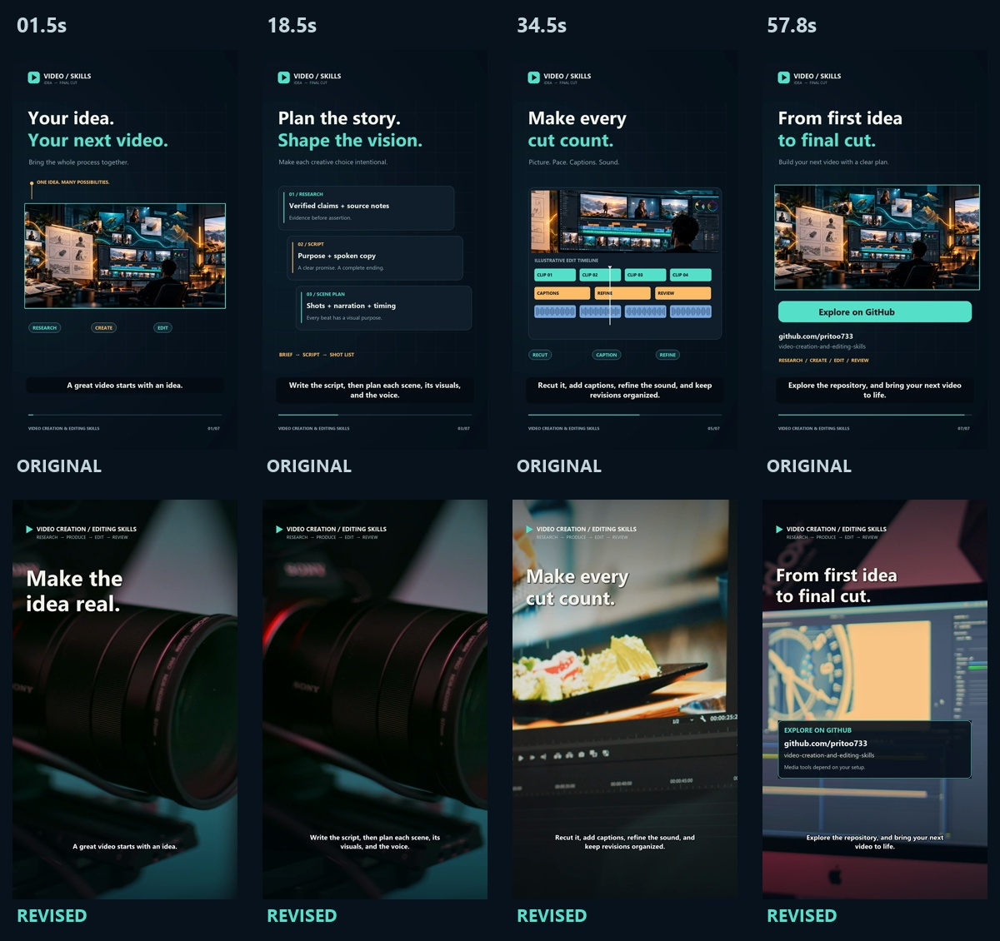

# Production workflow investigation and validation

Checked on 2026-10-15 using the original one-minute repository promo and a newly rendered version. The narrative, source audio mix, portrait frame size, and 60-second duration were held constant so the editorial treatment could be compared directly.



## Why the original looked like slides

The original project renderer built seven Pillow layouts (`intro`, `workflow`, `planning`, `formats`, `editing`, `portable`, `closing`) over a shared background, heading, and footer. Its imagery came from one repeated illustration and crops of that illustration. It had no primary video-decoding path, stock acquisition stage, or real footage intervals. A short layout dissolve, changing highlight, and progress line supplied most movement.

This was an implementation and review failure. The existing skill already warned about static-slide drift, but the production workflow allowed style frames as an alternative to a rendered motion pilot. The producer accepted readable layouts and successful export/transcription checks without establishing that the images carried the story. Installing a different rendering library alone would not fix those decisions.

## Reusable corrections

- Begin a footage-led production with source actions and shot selection, then add selective display copy. A shot list maps each interval to narration, purpose, crop, sound, transition, and rights.
- Distinguish genuine product evidence, illustrative stock, original animation, and deliberate stillness. Adapt the approach for promotional videos, explainers, tutorials, and social content; stock and frequent cuts are not universal requirements.
- Require a rendered multi-shot pilot for motion/editorial assessment. Still frames establish composition only. Reject a footage-led passage that communicates little beyond static slide replacement.
- Include an optional local manifest renderer with source trims, aspect-specific framing, timed/eased overlays, cuts/dissolves and other selected transitions, final audio, captions, cache logs, frame checks, and an edit record.
- Check individual stock asset terms and preserve evidence. The research rejected a suburban aerial clip whose free version was restricted to personal use, despite its appearance in a free stock library. Selected comparison assets explicitly used Mixkit Video Free terms permitting commercial projects.
- Separate technical, visual, editorial, and audio findings. Motion diagnostics locate passages to inspect and do not assign a professional-quality score.
- Install shared templates alongside the skills and fix installed reference paths, so the workflow works outside its source checkout.

See the [storytelling guide](../../skills/creating-videos/references/visual-storytelling.md), [stock guide](../../skills/creating-videos/references/stock-footage.md), [tool comparison](../../skills/creating-videos/references/production-tooling.md), and [composition guide](../../skills/editing-videos/references/shot-composition.md).

## Controlled comparison

| Observation | Original | Revised |
| --- | --- | --- |
| Runtime / frame size | 60s / 1080 × 1920 | 60s / 1080 × 1920 |
| Primary structure | 7 repeated layout states | 19 purposeful source shots |
| Native video source assets | 0 | 6 selected, licensed clips |
| Editorial joins | Layout changes with a uniform short blend | 13 hard cuts + 5 selected 0.2s dissolves |
| Center-region near-static sample pairs | 63.9% | 2.5% |
| Final audio wording vs script | No discrepancy in original review | No discrepancy in final ASR check |
| Final decode | Passed | Passed; 1,800 video frames at 30 fps |

The motion diagnostic sampled at 2 fps in a central region covering 80% of frame width and 60% of height. A pair was flagged near-static only when mean luma change was below 0.5/255 and fewer than 1.5% of pixels changed by more than 5/255. These are diagnostic settings for this comparison, not universal editorial thresholds. Camera movement, cuts, noise, and graphics can change the result. The source plan and sampled images establish that native footage was actually used.

The new sequence moves between camera preparation, a production setup, planning, an editor, a real timeline, and detailed workstation activity. Short labels introduce selected beats, while footage occupies the frame. The visible editing software is illustrative stock; it is not represented as software supplied by this repository.

## Checks and repairs

Six automated tests passed locally using Python 3.13 and FFmpeg 7.1. They cover transition overlap/runtime, invalid timing, missing stock-rights records, a real render with moving/still inputs, an overlay, captions, padded audio and a crossfade, rejection of a short source, and installation outside the checkout. The integration test checks decoded pixel colors through a crossfade rather than matching implementation text. Both skill metadata validators also passed.

The tests found a real frame-cadence/EOF problem: scaling before cadence normalization lost a final frame on this FFmpeg build. Normalizing cadence first and checking exact frame counts repaired it. Failed partial clips are not reused as completed cache entries.

The rendered pilot was 9.5 seconds. Final review generated 30 full-timeline samples plus 20 samples around five dissolves. Representative final-size frames and joins were inspected. That review caught and repaired a duplicated closing graphic and a panel obstructing a face. The final export decoded completely, retained every scripted word in local transcription, and measured about −16.7 LUFS integrated loudness with true peak around −1.4 dBFS. Confirm the exact readings in the project review record for any later export.

Continuous audiovisual playback and subjective listening were not established by these tools. The evidence validates the implemented footage workflow, timing, media ingestion, frame composition, and technical output; it does not certify audience engagement or an absolute level of creative quality. The owner can assess the synchronized before/after film with the same soundtrack.

Machine-readable findings are in [validation-results.json](validation-results.json); selected sources are in [asset-sources.json](asset-sources.json). Raw stock clips, voice models, project audio, and rendered MP4s remain outside the repository. A local production handoff includes the revised MP4, synchronized comparison MP4, subtitle sidecar, manifests, logs, and source/rights evidence.

## Reproduce the checks

Install a local FFmpeg build and set `FFMPEG_BIN` to its executable if it is not on PATH, then run:

```text
python -m unittest discover -s tests -v
```

Use the [composition guide](../../skills/editing-videos/references/shot-composition.md) to render a new local manifest. Choose and verify your own source passages, retain the source ledger, and supply a final mix/captions when needed. The repository does not redistribute raw stock or assume access to any provider account. Installing the skills provides the workflow and optional scripts; actual media, models, editing tools, and creative decisions still matter.
